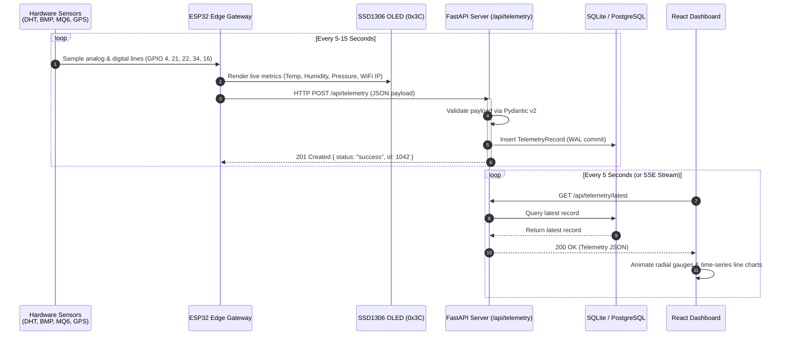
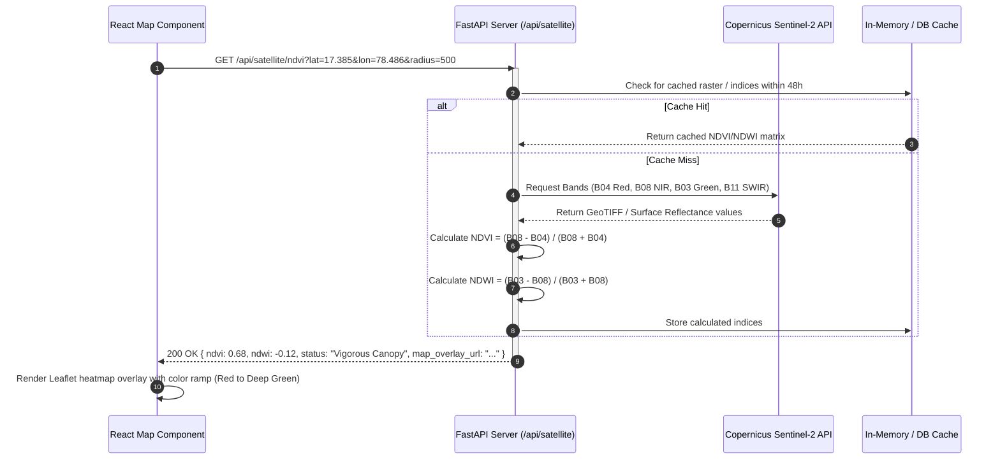
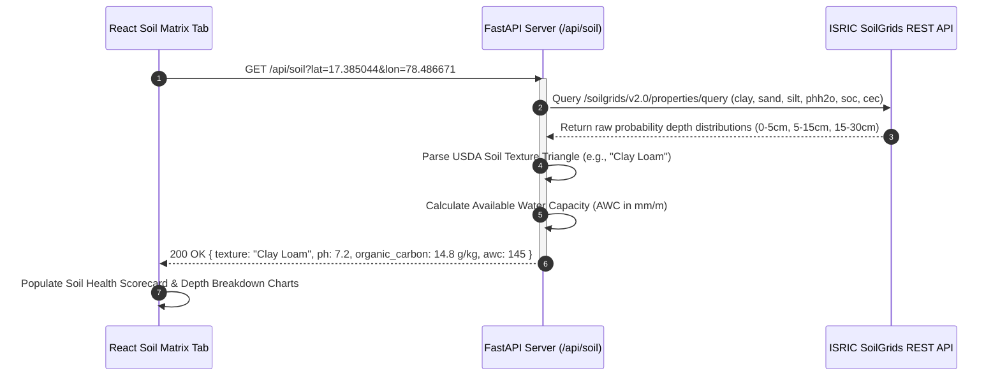
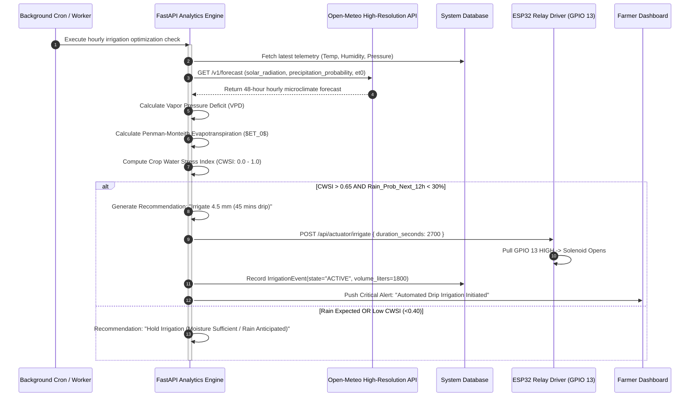
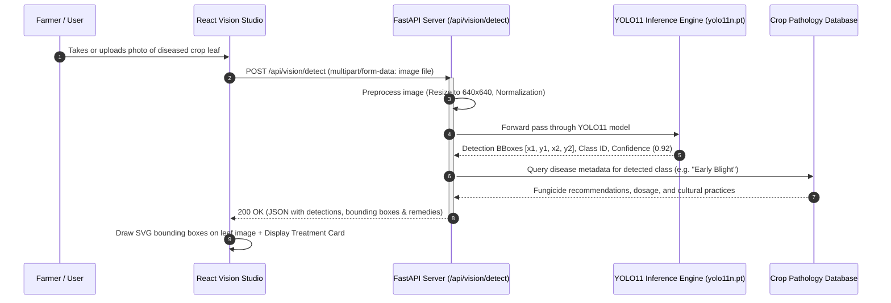
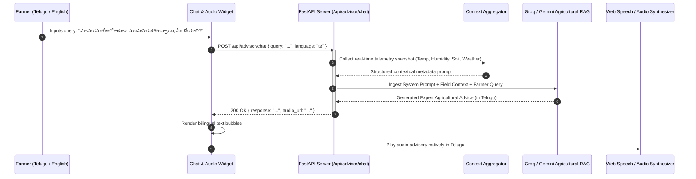

# AgriStack — Overall Data Flow Architecture

This document maps out the end-to-end data pipelines, communication protocols, request/response payloads, and sequence interactions across the **AgriStack Precision Agriculture & Climate Intelligence Platform**.

---

## 1. High-Level Data Flow Lifecycle

The platform operates across a continuous **5-Stage Data Lifecycle**:

```text
[ 1. SENSE ]  -->  [ 2. INGEST ]  -->  [ 3. ENRICH ]  -->  [ 4. INFER ]  -->  [ 5. ACT & DISPLAY ]
  ESP32 Edge         FastAPI REST        Copernicus Sat      YOLO11 Vision       React Dashboard
  DHT / BMP / MQ     Pydantic Schemas    SoilGrids 250m      CWSI Model          Bilingual Audio RAG
  GPS Coordinates    SQLite Storage      Open-Meteo          RAG Advisory        Relay Actuator Valve
```

---

## 2. Core Data Flow Pipelines & Sequence Diagrams

---

### Pipeline 1: Edge Telemetry Ingestion & Real-Time Sync Flow

Captures microclimate sensor data from the field, updates the local OLED display, and streams the metrics to the cloud server and frontend dashboard.



#### Pipeline 1 Data Payload Specification:
```json
// POST /api/telemetry
{
  "device_id": "esp32_gateway_01",
  "timestamp": 1729452800,
  "temperature": 29.4,
  "humidity": 68.2,
  "pressure": 1012.35,
  "gas_level": 412,
  "latitude": 17.385044,
  "longitude": 78.486671,
  "altitude": 542.1,
  "satellites": 8,
  "relay_state": false
}
```

---

### Pipeline 2: Earth Observation & Satellite Crop Health Flow

Leverages the European Space Agency's (ESA) Copernicus Sentinel-2 multispectral constellation to assess canopy health and crop water stress across the farm boundaries.



#### Pipeline 2 Data Payload Specification:
```json
// GET /api/satellite/ndvi Response
{
  "coordinates": { "latitude": 17.385044, "longitude": 78.486671 },
  "acquisition_date": "2026-10-18T05:22:10Z",
  "cloud_coverage_percentage": 2.4,
  "indices": {
    "ndvi": {
      "mean": 0.682,
      "min": 0.410,
      "max": 0.815,
      "classification": "Healthy Vegetative Biomass"
    },
    "ndwi": {
      "mean": -0.118,
      "classification": "Adequate Internal Leaf Moisture"
    }
  }
}
```

---

### Pipeline 3: Hyperlocal SoilGrids 250m Profile Ingestion Flow

Acquires deep soil physical and chemical parameters based on field coordinates without requiring physical soil lab tests.



#### Pipeline 3 Data Payload Specification:
```json
// GET /api/soil Response
{
  "texture_class": "Clay Loam",
  "ph": 7.2,
  "organic_carbon_g_kg": 14.8,
  "cation_exchange_capacity": 22.4,
  "depth_profiles": [
    { "depth": "0-5cm", "clay_percent": 34, "sand_percent": 38, "silt_percent": 28 },
    { "depth": "5-15cm", "clay_percent": 37, "sand_percent": 35, "silt_percent": 28 },
    { "depth": "15-30cm", "clay_percent": 41, "sand_percent": 32, "silt_percent": 27 }
  ],
  "water_holding_capacity": "High (145 mm/m)"
}
```

---

### Pipeline 4: Climate Forecast & Dynamic Irrigation Decision Flow

Merges physical edge readings (VPD) with meteorological forecasts (Open-Meteo) and soil water capacity to compute the **Crop Water Stress Index (CWSI)** and trigger automated irrigation.



---

### Pipeline 5: Computer Vision Disease Diagnosis Flow

Enables farmers to upload crop leaf photographs for instant pest identification and localized treatment instructions.



#### Pipeline 5 Data Payload Specification:
```json
// POST /api/vision/detect Response
{
  "diagnosis": "Early Blight (Alternaria solani)",
  "confidence": 0.941,
  "severity": "Moderate (Leaves 25% necrotic)",
  "detections": [
    {
      "box_2d": [142, 85, 310, 248],
      "label": "target_spot_lesion",
      "confidence": 0.94
    }
  ],
  "treatment": {
    "chemical_control": "Apply Mancozeb 75% WP @ 2.5g/L water or Chlorothalonil.",
    "organic_remedy": "Spray 5% Neem seed kernel extract (NSKE) or Trichoderma viride.",
    "cultural_practices": "Prune lower infected leaves; ensure drip irrigation avoids leaf wetting."
  }
}
```

---

### Pipeline 6: Bilingual Conversational RAG Advisory Flow

Empowers farmers to converse with an agricultural expert in **Telugu (తెలుగు)** or **English**, contextualized with real-time ground telemetry.



---

## 3. Latency, Refresh Rate & Polling Matrix

| Pipeline / Operation | Trigger Mechanism | Frequency / Cadence | End-to-End Latency Target |
| :--- | :--- | :--- | :--- |
| **ESP32 Sensor Ingest** | Hardware Timer | Every 10–30 Seconds | `< 150 ms` (Local WiFi) |
| **OLED Local Refresh** | Internal Loop | Every 1.0 Second | Instantaneous (`< 10 ms`) |
| **Dashboard Telemetry Sync**| HTTP Polling / SSE | Every 5.0 Seconds | `< 200 ms` |
| **YOLO11 Disease Diagnostic**| On-Demand User Upload | On User Request | `35 – 80 ms` (Inference) |
| **Open-Meteo Weather Sync** | Automated Polling | Every 1 Hour (Cached) | `< 400 ms` |
| **Copernicus Satellite Sync** | Background Scheduled | Every 2–5 Days (Orbit) | `1.5 – 3.0 s` (Initial fetch) |
| **SoilGrids Ingestion** | Location Onboarding | Once per Field (Static) | `< 800 ms` |
| **Bilingual RAG Advisory** | Farmer Message | On-Demand | `600 – 1500 ms` (Streamed) |
| **Actuator Relay Trigger** | Automated / Manual | Event-Driven | `< 300 ms` |
