# AgriStack — Hardware Pin Diagram & Wiring Specification

This document provides the complete hardware wiring blueprint, pin mapping, schematic diagrams, and electrical specifications for the **AgriStack ESP32 Edge Gateway**.

---

## 1. System Pinout Overview

| Module / Component | Interface | ESP32 Pin | Logic Level | Operating Voltage | Purpose / Description |
| :--- | :--- | :--- | :--- | :--- | :--- |
| **SSD1306 0.96" OLED** | I2C SDA | **GPIO 21** | 3.3V | 3.3V | Display Serial Data line |
| **SSD1306 0.96" OLED** | I2C SCL | **GPIO 22** | 3.3V | 3.3V | Display Serial Clock line |
| **BMP180 Barometer** | I2C SDA | **GPIO 21** | 3.3V | 3.3V | Barometric pressure & temperature SDA |
| **BMP180 Barometer** | I2C SCL | **GPIO 22** | 3.3V | 3.3V | Barometric pressure & temperature SCL |
| **DHT11 / DHT22** | 1-Wire GPIO | **GPIO 4** | 3.3V | 3.3V / 5V | Ambient temperature & relative humidity |
| **MQ-6 Gas Sensor** | Analog (ADC1) | **GPIO 34** | 0 - 3.3V (ADC) | 5V (Heater VCC) | Methane / LPG / Ammonia gas detection |
| **NEO-6M GPS Module** | UART2 TX -> RX | **GPIO 16 (RX2)**| 3.3V | 3.3V / 5V | Receives NMEA satellite coordinates ($GPRMC) |
| **NEO-6M GPS Module** | UART2 RX <- TX | **GPIO 17 (TX2)**| 3.3V | 3.3V / 5V | Transmits config / ACK to GPS (optional) |
| **Relay Actuator** | Digital Output | **GPIO 13** | 3.3V / 5V | 5V (VCC) | Triggers irrigation pump solenoid (Active HIGH) |
| **Status / Heartbeat LED**| Digital Output | **GPIO 2** | 3.3V | Built-in | Blinks on WiFi connection & HTTP telemetry |
| **Power Supply Input** | USB / Vin | **VIN / 5V** | — | 5.0V DC | Main system power from USB or DC source |
| **System Ground** | Common Ground| **GND** | 0V | 0V | Common ground across all peripherals |

> [!NOTE]
> **Free / Unused Pins:**
> - **GPIO 26 & 27**: Free (GSM / SIM800L module removed).
> - **GPIO 35**: Free (Physical soil moisture probe ADC removed; soil moisture is derived from Copernicus Sentinel-2 satellite & SoilGrids models).

---

## 2. ESP32 (30-Pin NodeMCU) Physical Pin Diagram

```text
                             +-------------------+
                             |     [Micro-USB]   |
                             |   [ESP-WROOM-32]  |
                             |                   |
               EN (Reset) ---|  1             30 |--- CLK
   MQ-6 Analog (GPIO 34)  ---|  2 (GPI34)     29 |--- SD0
               (GPI35)    ---|  3 (GPI35)     28 |--- SD1
               (GPI32)    ---|  4 (GPIO32)    27 |--- SD2
               (GPI33)    ---|  5 (GPIO33)    26 |--- SD3
               (GPIO25)   ---|  6 (GPIO25)    25 |--- CMD
       (Free)  (GPIO26)   ---|  7 (GPIO26)    24 |--- GPIO23
       (Free)  (GPIO27)   ---|  8 (GPIO27)    23 |--- GPIO22 (I2C SCL) ---> [OLED + BMP180]
  Relay Drive  (GPIO13)   ---|  9 (GPIO13)    22 |--- GPIO1 (TX0)
         GND   (GND)      ---| 10 (GND)       21 |--- GPIO3 (RX0)
  GPS RX (TX)  (GPIO16)   ---| 11 (RX2)       20 |--- GPIO21 (I2C SDA) ---> [OLED + BMP180]
  GPS TX (RX)  (GPIO17)   ---| 12 (TX2)       19 |--- GND
DHT11/22 Data  (GPIO4)    ---| 13 (GPIO4)     18 |--- GPIO19
   Status LED  (GPIO2)    ---| 14 (GPIO2)     17 |--- GPIO18
               (GPIO15)   ---| 15 (GPIO15)    16 |--- GPIO5
                             |                   |
              3V3 (Power) ---| 16             15 |--- 5V / VIN (Power Input)
                             +-------------------+
```

---

## 3. Circuit Schematic Diagram (Mermaid)

```mermaid
graph TD
    subgraph ESP32 ["ESP32 Development Board"]
        P_3V3["3.3V Pin"]
        P_5V["5V / VIN Pin"]
        P_GND["GND (Common Ground)"]
        P_G21["GPIO 21 (SDA)"]
        P_G22["GPIO 22 (SCL)"]
        P_G4["GPIO 4 (DHT Data)"]
        P_G34["GPIO 34 (ADC1_6)"]
        P_G16["GPIO 16 (RX2)"]
        P_G17["GPIO 17 (TX2)"]
        P_G13["GPIO 13 (Relay Out)"]
        P_G2["GPIO 2 (Status LED)"]
    end

    subgraph I2C_Bus ["I2C Bus (Multi-Drop)"]
        OLED["SSD1306 128x64 OLED (0x3C)"]
        BMP["BMP180 Barometer (0x77)"]
    end

    subgraph Sensors ["Environmental Sensors"]
        DHT["DHT11 / DHT22 Sensor"]
        MQ6["MQ-6 Gas Sensor"]
        GPS["NEO-6M GPS Module"]
    end

    subgraph Actuators ["Actuators & Indicators"]
        RELAY["5V Single-Channel Relay Module"]
        PUMP["Irrigation Solenoid / Pump"]
    end

    %% I2C Connections
    P_G21 -->|SDA| OLED
    P_G21 -->|SDA| BMP
    P_G22 -->|SCL| OLED
    P_G22 -->|SCL| BMP

    %% Sensor Connections
    P_G4 -->|1-Wire Serial| DHT
    MQ6 -->|Analog Output 0-3.3V| P_G34
    GPS -->|GPS TX -> ESP32 RX| P_G16
    P_G17 -->|ESP32 TX -> GPS RX| GPS

    %% Relay Connections
    P_G13 -->|IN1 Signal| RELAY
    RELAY -.->|NO / COM Contact| PUMP

    %% Power Distribution
    P_3V3 ==>|VCC 3.3V| OLED
    P_3V3 ==>|VCC 3.3V| BMP
    P_3V3 ==>|VCC 3.3V| DHT
    P_5V ==>|VCC 5V| MQ6
    P_5V ==>|VCC 5V| GPS
    P_5V ==>|VCC 5V| RELAY

    %% Ground Distribution
    P_GND ===|GND| OLED
    P_GND ===|GND| BMP
    P_GND ===|GND| DHT
    P_GND ===|GND| MQ6
    P_GND ===|GND| GPS
    P_GND ===|GND| RELAY
```



---

## 4. Module-by-Module Wiring Details

### 4.1 SSD1306 0.96" OLED Display (128x64, I2C: 0x3C)
The OLED provides real-time field status, WiFi IP address, sensor readings, and irrigation state.
- **VCC** -> Connect to **3.3V** on ESP32
- **GND** -> Connect to **GND** on ESP32
- **SCL** -> Connect to **GPIO 22** on ESP32
- **SDA** -> Connect to **GPIO 21** on ESP32

> [!TIP]
> Both the OLED (`0x3C`) and the BMP180 (`0x77`) share GPIO 21 (SDA) and GPIO 22 (SCL). Connect them to the same breadboard rails in parallel.

---

### 4.2 BMP180 Barometric Pressure & Temperature Sensor (I2C: 0x77)
Measures atmospheric pressure (hPa) for altitude calculation and localized rain prediction.
- **VCC** -> Connect to **3.3V** on ESP32
- **GND** -> Connect to **GND** on ESP32
- **SCL** -> Connect to **GPIO 22** on ESP32
- **SDA** -> Connect to **GPIO 21** on ESP32

---

### 4.3 DHT11 / DHT22 Temperature & Humidity Sensor
Measures ambient field temperature (°C) and relative humidity (%).
- **VCC (Pin 1)** -> Connect to **3.3V** (or 5V if using a sensor module with built-in regulator)
- **DATA (Pin 2)** -> Connect to **GPIO 4** on ESP32
  - *Recommendation:* Place a **4.7kΩ to 10kΩ pull-up resistor** between DATA and 3.3V (most 3-pin breakout modules have this resistor pre-soldered).
- **NC (Pin 3 - 4-pin version only)** -> Not Connected
- **GND (Pin 4)** -> Connect to **GND** on ESP32

---

### 4.4 MQ-6 Gas Sensor (LPG, Isobutane, Methane)
Monitors biogas leaks or soil anaerobic decomposition gas levels.
- **VCC** -> Connect to **5V / VIN** on ESP32 (MQ heaters require 5V)
- **GND** -> Connect to **GND** on ESP32
- **AOUT (Analog Out)** -> Connect to **GPIO 34** (ADC1_CH6) on ESP32
- **DOUT (Digital Out)** -> Leave disconnected (we read raw continuous analog values)

> [!CAUTION]
> GPIO 34 is an **input-only** analog pin on ADC1. It supports voltages from 0 to 3.3V. Ensure the sensor output does not exceed 3.3V, or use a 2:1 resistive divider (e.g. 10kΩ / 20kΩ) if the analog voltage reaches 5V under heavy gas concentration.

---

### 4.5 NEO-6M / GT-U7 GPS Receiver Module
Transmits latitude, longitude, altitude, and satellite lock status to automatically geolocate the field without manual farmer input.
- **VCC** -> Connect to **5V / VIN** (or 3.3V depending on module regulator)
- **GND** -> Connect to **GND** on ESP32
- **TX** -> Connect to **GPIO 16 (RX2)** on ESP32
- **RX** -> Connect to **GPIO 17 (TX2)** on ESP32 (Optional)

---

### 4.6 5V Single-Channel Relay Module (Irrigation Solenoid)
Actuates the drip irrigation valve or submersible water pump upon backend recommendation.
- **VCC** -> Connect to **5V / VIN** on ESP32
- **GND** -> Connect to **GND** on ESP32
- **IN / Signal** -> Connect to **GPIO 13** on ESP32
- **Output Terminals:**
  - **COM (Common)** -> To positive terminal of 12V/24V pump power source
  - **NO (Normally Open)** -> To positive lead of pump/solenoid
  - **NC (Normally Closed)** -> Leave empty

---

## 5. Breadboard Assembly Step-by-Step

1. **Power Rails:**
   - Connect ESP32 **3.3V** to the breadboard **Red (+) Rail**.
   - Connect ESP32 **5V/VIN** to a second **5V Rail** (or direct jumpers).
   - Connect ESP32 **GND** to the breadboard **Blue (-) Rail**.
2. **I2C Bus:**
   - Bridge OLED `SCL` and BMP180 `SCL` to ESP32 `GPIO 22`.
   - Bridge OLED `SDA` and BMP180 `SDA` to ESP32 `GPIO 21`.
   - Connect both module grounds to `GND Rail` and VCCs to `3.3V Rail`.
3. **DHT Sensor:**
   - Connect VCC to `3.3V Rail`, GND to `GND Rail`, and DATA to ESP32 `GPIO 4`.
4. **MQ-6 Sensor:**
   - Connect VCC to `5V Rail`, GND to `GND Rail`, and AOUT to ESP32 `GPIO 34`.
5. **GPS Module:**
   - Connect VCC to `5V Rail`, GND to `GND Rail`, TX to ESP32 `GPIO 16`.
6. **Relay Module:**
   - Connect VCC to `5V Rail`, GND to `GND Rail`, and IN to ESP32 `GPIO 13`.

---

## 6. Hardware Verification & Diagnostic Checklist

Before powering on the field unit, perform these sanity checks:

- [ ] **No Short Circuits:** Test resistance between 3.3V and GND using a multimeter; ensure it is not 0 ohms.
- [ ] **I2C Address Verification:** Open Serial Monitor at `115200` baud. Ensure the I2C scanner reports `0x3C` (OLED) and `0x77` (BMP180).
- [ ] **OLED Display Test:** The display should immediately light up with the AgriStack bootscreen and show IP address once WiFi connects.
- [ ] **GPS Satellite Lock:** The NEO-6M tiny blue LED will blink once satellite fix is acquired (usually 30–90 seconds outdoors).
- [ ] **Relay Test:** Triggering `/api/actuator/irrigate` should produce an audible click on the relay and illuminate its onboard indicator LED.
