# AgriStack — Overall System Architecture

This document outlines the architectural blueprints, system layers, component interactions, and technical design decisions powering the **AgriStack Precision Agriculture & Climate Intelligence Platform**.

---

## 1. High-Level Architectural Blueprint

AgriStack is designed as a **6-Tier Distributed Intelligence Architecture** bridging low-power edge hardware in the field with global Earth observation satellites, real-time meteorological models, and modern AI inference engines.

```mermaid
graph TB
    subgraph T1 ["Tier 1: Edge & Field Sensing Layer (IoT)"]
        ESP32["ESP32 Gateway Node"]
        DHT["DHT11/22 (Temp & Humidity)"]
        BMP["BMP180 (Atm Pressure)"]
        MQ6["MQ-6 (Biogas/LPG/Air Quality)"]
        GPS["NEO-6M GPS (Geolocation)"]
        OLED["SSD1306 128x64 OLED (Live Status)"]
        RELAY["Relay Solenoid (Irrigation Valve)"]
    end

    subgraph T2 ["Tier 2: Ingestion & Telemetry Gateway"]
        FASTAPI["FastAPI High-Throughput Server (ASGI / Uvicorn)"]
        ROUTERS["Modular APIRouters (/telemetry, /soil, /weather, /satellite, /advisor, /vision)"]
        VALIDATOR["Pydantic v2 Schema Validation Engine"]
    end

    subgraph T3 ["Tier 3: Persistence & State Management Layer"]
        DB[(SQLite / PostgreSQL via SQLModel & SQLAlchemy)]
        CACHE["In-Memory Cache (Weather & Satellite Geo-bounds)"]
    end

    subgraph T4 ["Tier 4: Global Earth Observation & Geospatial Services"]
        SENTINEL["Copernicus Sentinel-2 API<br/>(10m Multispectral Bands: B04 Red, B08 NIR, B03 Green, B11 SWIR)"]
        SOILGRIDS["ISRIC SoilGrids 250m REST API<br/>(Clay, Sand, Silt, pH, Organic Carbon, CEC)"]
        OPENMETEO["Open-Meteo High-Resolution Weather API<br/>(Hourly Solar Radiation, ET0, Precipitation)"]
    end

    subgraph T5 ["Tier 5: Artificial Intelligence & Analytical Models"]
        YOLO["YOLO11 Computer Vision Engine<br/>(Crop Disease, Pest Detection & Bounding Boxes)"]
        CWSI["CWSI & Evapotranspiration Decision Engine<br/>(Crop Water Stress Index & Irrigation Logic)"]
        RAG["Bilingual Contextual RAG Engine<br/>(LLM Advisory in Telugu & English via Groq / Gemini)"]
    end

    subgraph T6 ["Tier 6: Presentation & Farmer Interaction Layer"]
        DASHBOARD["React 18 + Vite SPA Dashboard"]
        MAPS["Leaflet GIS Multispectral Field Map"]
        AUDIO["Bilingual Voice Synthesis & Audio Advisory (Telugu/English)"]
        ACT_CTRL["One-Click Remote Actuator Control"]
    end

    %% Connections from Tier 1 to Tier 2
    DHT --> ESP32
    BMP --> ESP32
    MQ6 --> ESP32
    GPS --> ESP32
    ESP32 --> OLED
    ESP32 -->|WiFi HTTP POST /api/telemetry| FASTAPI
    FASTAPI -.->|HTTP POST Actuator Command| RELAY

    %% Connections in Tier 2 & Tier 3
    FASTAPI --> VALIDATOR
    VALIDATOR --> ROUTERS
    ROUTERS --> DB
    ROUTERS --> CACHE

    %% Connections to Tier 4
    ROUTERS <-->|REST Requests & Geo-Polygons| SENTINEL
    ROUTERS <-->|Spatial Lat/Lon Query| SOILGRIDS
    ROUTERS <-->|Microclimate Forecast Query| OPENMETEO

    %% Connections to Tier 5
    ROUTERS <-->|Image Inference| YOLO
    ROUTERS <-->|Telemetry + Soil + Weather| CWSI
    ROUTERS <-->|Telemetry Context + Farmer Query| RAG

    %% Connections to Tier 6
    FASTAPI <-->|REST APIs + SSE Live Stream| DASHBOARD
    DASHBOARD --> MAPS
    DASHBOARD --> AUDIO
    DASHBOARD --> ACT_CTRL
```

---

## 2. Layer-by-Layer Architectural Breakdown

### 2.1 Tier 1: Edge & Field Sensing Layer (IoT)
- **Role:** Real-time physical environment sampling, autonomous local display, and telemetry transmission.
- **Hardware:** Espressif ESP32 dual-core microcontroller (240MHz, 520KB SRAM).
- **Core Firmware Responsibilities:**
  - Non-blocking cooperative multitasking loop (`millis()` based).
  - Driverless zero-dependency bitmapped graphics rendering on the SSD1306 OLED via I2C (`Wire.h`).
  - Bit-banged timing extraction for DHT11/22 single-wire protocol.
  - Hardware UART2 streaming parser for NMEA GPS sentences (`$GPRMC`, `$GPGGA`).
  - Periodic HTTP client posting telemetry payloads every 10–30 seconds to the backend server.
  - Local HTTP REST web server listening on port 80 to accept direct manual override commands (`/pump/on`, `/pump/off`).

### 2.2 Tier 2: Ingestion & Telemetry Processing Layer
- **Role:** High-concurrency async HTTP server handling ingestion, validation, and API routing.
- **Technology:** Python 3.10+, FastAPI, Starlette, Pydantic v2, Uvicorn ASGI.
- **Core Endpoints:**
  - `POST /api/telemetry`: Ingests sensor readings from ESP32 with timestamping and field association.
  - `GET /api/telemetry/latest`: Fetches the most recent live sensor snapshot for dashboard widgets.
  - `GET /api/soil?lat={lat}&lon={lon}`: Retrieves physical and chemical soil properties.
  - `GET /api/weather?lat={lat}&lon={lon}`: Delivers 7-day microclimate forecasts with solar radiation.
  - `GET /api/satellite/ndvi?lat={lat}&lon={lon}`: Returns multispectral vegetation and water stress indices.
  - `POST /api/vision/detect`: Receives crop leaf photos and executes YOLO11 disease diagnostics.
  - `POST /api/advisor/chat`: Executes bilingual context-aware RAG recommendations.
  - `POST /api/actuator/irrigate`: Triggers physical pump activation via the ESP32.

### 2.3 Tier 3: Persistence & State Management Layer
- **Role:** Reliable ACID-compliant persistence for telemetry history, farm profiles, and diagnostic logs.
- **Database Engine:** SQLite (with WAL mode enabled) for zero-configuration hackathon and local edge deployment; seamlessly migratable to PostgreSQL in production via SQLModel / SQLAlchemy ORM.
- **Data Models:**
  - `TelemetryRecord`: Raw sensor logs (temperature, humidity, pressure, gas level, GPS fix, relay state).
  - `FarmProfile`: Boundary coordinates, soil type, primary crop cultivar, planting date.
  - `SoilProfile`: Sand/clay/silt ratios, pH level, cation exchange capacity (CEC), organic carbon.
  - `DiseaseDetection`: Timestamp, input image path, detected class, confidence score, treatment regimen.

### 2.4 Tier 4: Global Earth Observation & Geospatial Services
- **Copernicus Sentinel-2 Integration:**
  - Consumes 10-meter spatial resolution multispectral imagery.
  - Computes **NDVI (Normalized Difference Vegetation Index)**:
    $$\text{NDVI} = \frac{\text{NIR} - \text{Red}}{\text{NIR} + \text{Red}} = \frac{B08 - B04}{B08 + B04}$$
  - Computes **NDWI (Normalized Difference Water Index)**:
    $$\text{NDWI} = \frac{\text{Green} - \text{NIR}}{\text{Green} + \text{NIR}} = \frac{B03 - B08}{B03 + B08}$$
- **ISRIC SoilGrids 250m System:**
  - Queries global machine-learning-derived soil property maps at standard depth intervals (`0-5cm`, `5-15cm`, `15-30cm`).
  - Feeds soil water retention capacity into the irrigation calculation without requiring expensive laboratory soil testing.
- **Open-Meteo High-Resolution Meteorological Engine:**
  - Provides hourly shortwave solar radiation ($W/m^2$), vapor pressure deficit (VPD), relative humidity, precipitation probabilities, and reference evapotranspiration ($ET_0$).

### 2.5 Tier 5: Artificial Intelligence & Analytical Models
- **YOLO11 Vision Model (`yolo11n.pt`):**
  - Lightweight, high-accuracy neural network capable of inferring on edge CPU/GPU in under 50ms.
  - Detects plant leaf blight, rust, powdery mildew, caterpillar infestations, and nutrient deficiencies.
- **CWSI & Dynamic Irrigation Decision Engine:**
  - Combines physical ambient vapor pressure deficit (VPD) from DHT/BMP sensors with satellite NDWI and SoilGrids drainage capacity to compute crop water stress.
  - Prevents under-irrigation (crop withering) and over-irrigation (water waste, root rot, nitrate leaching).
- **Bilingual Context-Aware RAG Advisor:**
  - Powered by Groq / Gemini LLMs.
  - Grounded with real-time farm telemetry: current temperature, soil matrix, weather outlook, and disease diagnosis history.
  - Full native support for **Telugu (తెలుగు)** and **English**, rendering colloquial agricultural vernacular understandable to rural smallholder farmers.

### 2.6 Tier 6: Presentation & Farmer Interaction Layer
- **Tech Stack:** React 18, TypeScript, Vite, TailwindCSS / CSS variables, Lucide React icons.
- **Key Modules:**
  - **Live Field Telemetry Gauges:** Instantaneous gauges for temperature, humidity, pressure, gas concentration, and GPS fix.
  - **Multispectral Map Visualizer:** Leaflet-based interactive farm map with NDVI/NDWI color gradient overlays.
  - **Soil Health Matrix:** Interactive multi-depth visual cards showing pH, organic carbon, and texture classifications.
  - **Leaf AI Diagnostic Studio:** Drag-and-drop crop photo uploader with real-time bounding box annotations and treatment instructions.
  - **Interactive Bilingual Advisory Chat:** Audio-enabled conversational assistant with quick-prompt chips ("నీటిపారుదల సలహా", "ఎరువుల యాజమాన్యం", "తెగుళ్ల నివారణ").

---

## 3. Security, Resilience & Fail-Safe Architecture

1. **Network Disconnection Resilience (Edge Gateway):**
   - If WiFi is lost, the ESP32 continues autonomous local monitoring, displaying sensor values on the I2C OLED display.
   - It maintains a sliding buffer and automatically reconnects with exponential backoff without resetting the board.
2. **Input Validation & Sanitization:**
   - Every telemetry packet is validated through Pydantic v2 schemas; out-of-range sensor spikes (e.g. DHT checksum failures) are rejected before DB insertion.
3. **Hardware Fail-Safe:**
   - The relay driver defaults to `LOW` (Normally Open / OFF) upon boot or power cycle, preventing catastrophic field flooding during gateway reboots.
4. **Environment Secret Management:**
   - All third-party API credentials (LLM keys, Copernicus tokens) are strictly stored in `.env` and kept out of version control.
